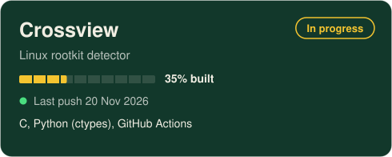
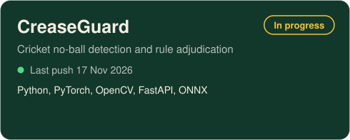
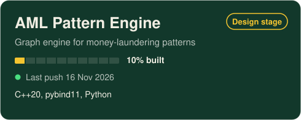
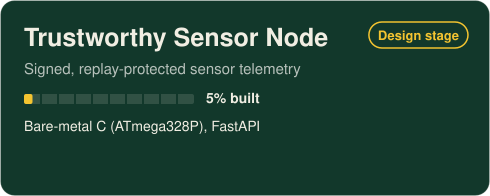
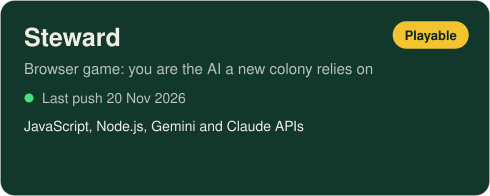
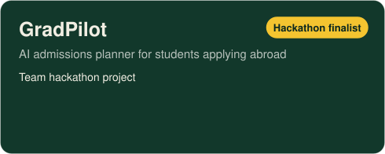
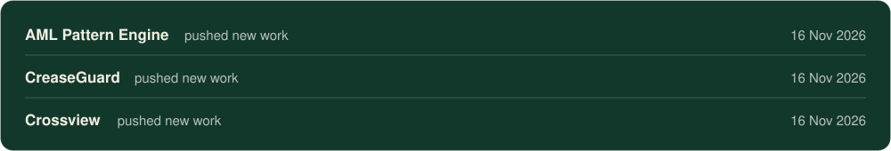
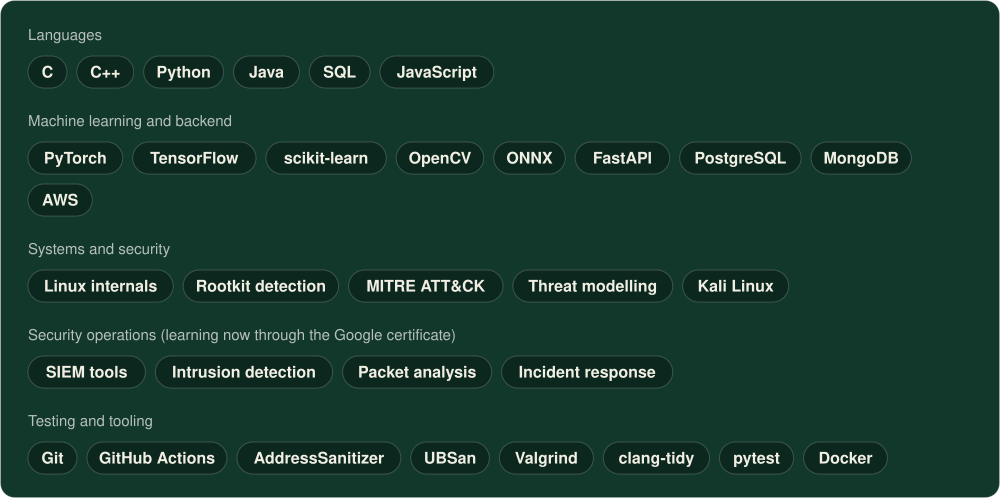
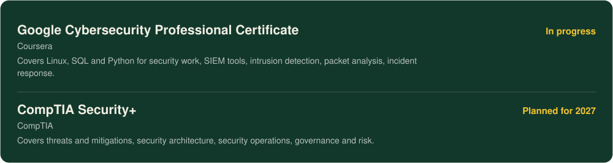

### About me

Computer science undergraduate at VIT Chennai (graduating June 2028), moving from AI and machine learning into cybersecurity and systems. My projects pair a low-level engine in C or C++ with a Python layer on top, and I only publish numbers that a script produced. I lead research and development at the Business Innovators Community and I'm working towards a security and systems role.

[Portfolio site](https://divide317.github.io/cv-site/) · [Résumé (PDF)](https://divide317.github.io/cv-site/Cedric_Antony_Joseph_Resume.pdf) · [LinkedIn](https://www.linkedin.com/in/cedric-antony-joseph-5b68b4224/)

### Projects

 

 

 

### Contributions and recent work

### Skills

### Currently learning

This page rebuilds itself every few hours from <a href="https://github.com/Divide317/cv-site/blob/main/status.js">status.js</a> and the GitHub API.
